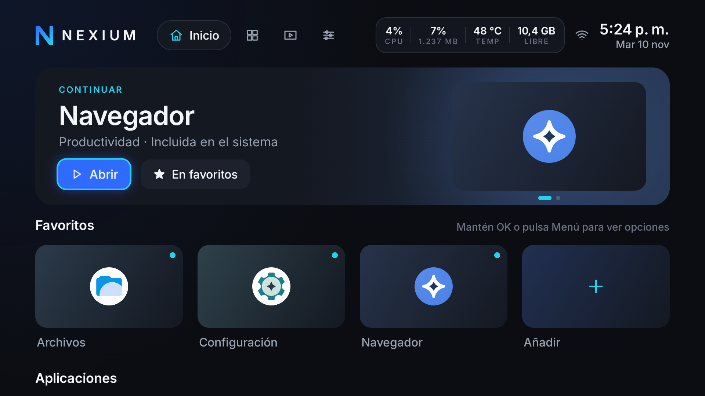
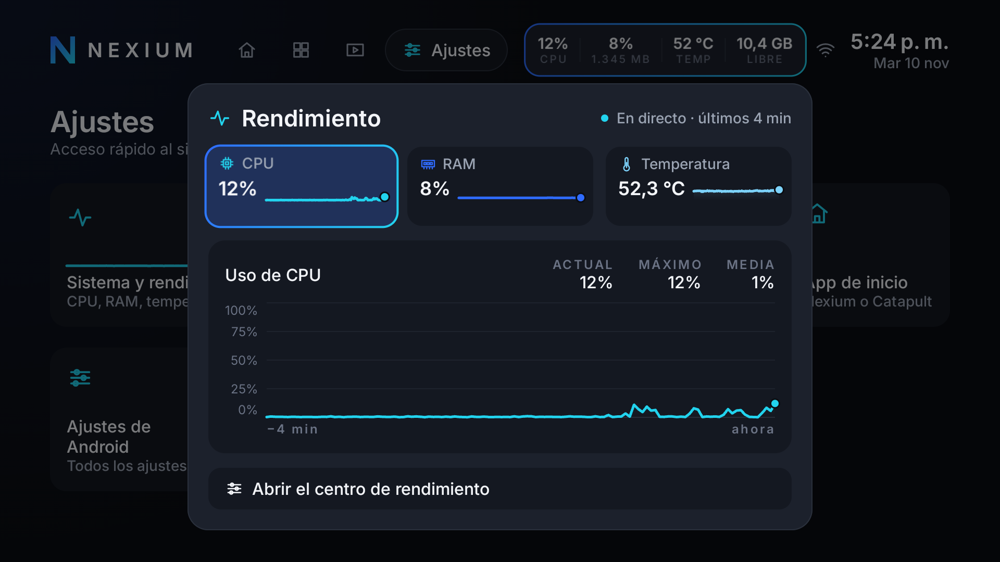
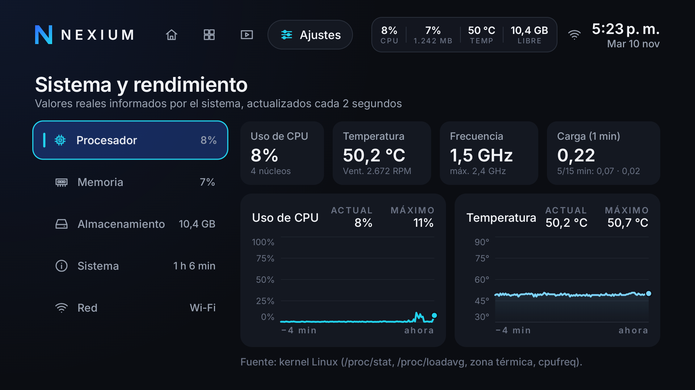
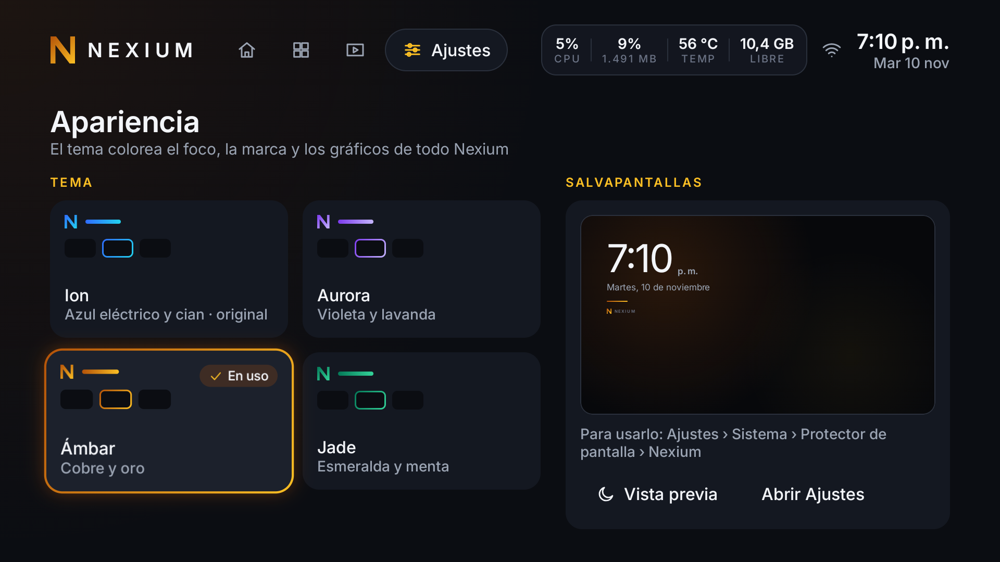
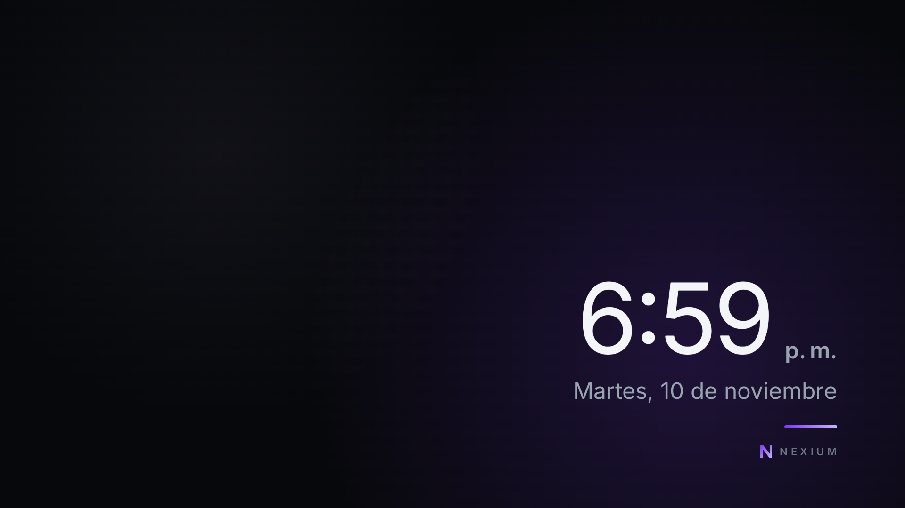

# Krelzox OS

[](https://github.com/Nach0t/Krelzox-OS/actions/workflows/android.yml)


[English](README.md) · **Español**

Una experiencia Android TV premium para Raspberry Pi 5. Su primer componente es
**Krelzox Launcher** (`dev.krelzox.launcher`): una pantalla de inicio en Kotlin y
Jetpack Compose for TV que se instala como una app normal, sin root, sin
modificar la ROM y conservando siempre el launcher del sistema como red de
seguridad.

*Antes se llamaba Nexium OS.*



## Características

**Pantalla de inicio**
- Carrusel dinámico: la app que estabas usando (*Continuar*), apps recientes,
  favoritos y sugerencias.
- Fila de favoritos con reordenación en directo y fila de aplicaciones;
  pestañas **Biblioteca** (todas las apps) y **Multimedia** (apps de vídeo,
  audio e imagen).
- Pensada para el mando: todo funciona con el D-pad, el foco nunca se pierde y
  Back es jerárquico.

**Monitor de rendimiento**
- Panel permanente en la barra superior: CPU, RAM, temperatura y almacenamiento
  libre.
- Vista ampliada con gráficos en tiempo real de los últimos 4 minutos (actual,
  máximo y media).
- Centro **Sistema y rendimiento** en Ajustes: procesador (uso, temperatura,
  frecuencia, carga, ventilador), memoria, almacenamiento, sistema y red.
- Solo valores reales, con su fuente en pantalla. Si el sistema bloquea una
  fuente, la métrica indica *No disponible*: nunca se estima.

| Vista ampliada | Centro de rendimiento |
|---|---|
|  |  |

**Apariencia y salvapantallas**
- Cuatro temas (Ion, el original; Aurora, Ámbar y Jade) que recolorean todo el
  sistema a la vez: foco, marca, gráficos y salvapantallas. Cada tarjeta de tema
  muestra su propio foco antes de elegirlo.
- Salvapantallas de Krelzox: hora, fecha y la luz del tema sobre grafito
  profundo. Cambia de posición cada minuto para cuidar la pantalla y apenas usa
  la CPU.
- Mosaico Raspberry Pi que indica dónde están exactamente los ajustes de
  hardware de KonstaKANG (Android no permite que otras apps los abran
  directamente).

| Apariencia | Salvapantallas |
|---|---|
|  |  |

**Fiabilidad**
- Funciona como app de inicio (HOME), con **modo seguro**: tras 3 cierres por
  error en 2 minutos abre una pantalla mínima para elegir otro launcher o abrir
  Ajustes.
- El launcher del sistema (Catapult) nunca se deshabilita; la
  [guía de recuperación](docs/recuperacion.md) cubre todas las vías de vuelta.

**Rendimiento y privacidad**
- Baseline Profile + R8: APK release de 2,8 MB; navegación con D-pad con < 1 %
  de frames con tirones incluso justo después de instalar; arranque en frío muy
  por debajo de 600 ms.
- Un único permiso, normal (`ACCESS_NETWORK_STATE`); los temas y el
  salvapantallas no añaden ninguno. Sin root, sin telemetría, sin anuncios.

## Plataforma objetivo

| | |
|---|---|
| Hardware | Raspberry Pi 5 Model B Rev 1.1, 16 GB de RAM |
| Sistema | LineageOS 24.0 (Android TV 17, SDK 37), build KonstaKANG `rpi5_tv` |
| Pantalla | 1920×1080 @ 60 Hz, 320 dpi (960×540 dp) |
| GPU | Broadcom V3D (Mesa GLES 3.1 / Vulkan 1.4) |

El dispositivo no tiene Google Mobile Services. Krelzox funciona en otros
dispositivos Android TV con SDK 31 o superior, pero se diseña y se mide en este.

## Primeros pasos

Requisitos: JDK 21, Android SDK (plataforma 37) y acceso ADB al dispositivo.

```sh
./gradlew assembleRelease          # app/build/outputs/apk/release/app-release-unsigned.apk
```

Firmar el APK (para desarrollo basta la clave de depuración local) e instalarlo:

```sh
apksigner sign --ks ~/.android/debug.keystore --ks-pass pass:android \
  --ks-key-alias androiddebugkey --out krelzox.apk \
  app/build/outputs/apk/release/app-release-unsigned.apk
adb install -r krelzox.apk
```

Convertirlo en la app de inicio (totalmente reversible; ver la
[guía de recuperación](docs/recuperacion.md)):

```sh
adb shell cmd role add-role-holder android.app.role.HOME dev.krelzox.launcher
```

En Windows, los comandos equivalentes están en [docs/entorno.md](docs/entorno.md).

## Desarrollo

| Comando | Qué hace | Dónde |
|---|---|---|
| `./gradlew testDebugUnitTest lintDebug` | Tests unitarios y lint | CI + local |
| `./gradlew assembleRelease` | Build release (R8 + Baseline Profile) | CI + local |
| `./gradlew :app:connectedDebugAndroidTest` | Pruebas de UI de foco con D-pad | Dispositivo |
| `./gradlew :app:generateBaselineProfile -Pandroid.injected.androidTest.leaveApksInstalledAfterRun=true` | Regenera el Baseline Profile (la opción conserva Krelzox y sus datos) | Dispositivo |
| `./gradlew :baselineprofile:connectedBenchmarkReleaseAndroidTest` | Macrobenchmark de arranque en frío | Dispositivo |

Las builds debug usan el paquete `dev.krelzox.launcher.debug`, así que las
pruebas nunca reemplazan ni desinstalan el launcher en uso. Procedimientos y
resultados en el dispositivo: [docs/rendimiento.md](docs/rendimiento.md).

El CI (GitHub Actions) ejecuta tests unitarios, lint y la build release, y
compila las pruebas de dispositivo en cada push y pull request; publica un
resumen (tests, lint, tamaño del APK, Baseline Profile). Dependabot propone
cada semana actualizaciones de dependencias.

## Estructura del proyecto

```
app/                 Launcher: actividad, shell, Inicio / Biblioteca / Multimedia / Ajustes, UI de rendimiento
core/designsystem/   Tokens, tema (Inter), iconos, gráficos; sin dependencias de datos
core/data/           Apps, favoritos, recientes, red, métricas del sistema
baselineprofile/     Generador del Baseline Profile y benchmarks de arranque (se ejecuta en el dispositivo)
docs/                Arquitectura, identidad visual, hoja de ruta, ADR
```

## Documentación

- [Arquitectura](docs/arquitectura.md) · [Identidad visual](docs/identidad-visual.md) · [Hoja de ruta](docs/hoja-de-ruta.md)
- [Entorno de desarrollo](docs/entorno.md) · [Rendimiento y pruebas en el dispositivo](docs/rendimiento.md)
- [Recuperación del dispositivo](docs/recuperacion.md) · [Dispositivo de referencia](docs/dispositivo.md)
- Decisiones técnicas (ADR): [docs/decisiones/](docs/decisiones/)

## Contribuir

Las contribuciones son bienvenidas. Lee la [guía de contribución](CONTRIBUTING.md)
y el [código de conducta](CODE_OF_CONDUCT.md) (en inglés) antes de abrir un issue
o un pull request. El estado de la accesibilidad y sus limitaciones conocidas
están en [ACCESSIBILITY.md](ACCESSIBILITY.md).

## Convenciones

- Código, identificadores y mensajes de commit: **inglés**.
- README: inglés y español. Documentación detallada (`docs/`): **español**.

## Seguridad

Para informar de una vulnerabilidad, sigue la [política de seguridad](SECURITY.md)
(en inglés); nunca uses issues públicos.

No subas claves de firma (`*.jks`, `*.keystore`), contraseñas, tokens,
`local.properties` ni logs del dispositivo. El `.gitignore` los excluye, pero
revisa siempre `git status` antes de un commit. Las capturas de la pantalla de
Red muestran las direcciones IP del dispositivo y no deben publicarse.

## Licencia

Apache License 2.0. Ver [LICENSE](LICENSE).

Incluye la tipografía **Inter** © The Inter Project Authors, bajo SIL Open
Font License 1.1 ([third_party/inter/OFL.txt](third_party/inter/OFL.txt)).
