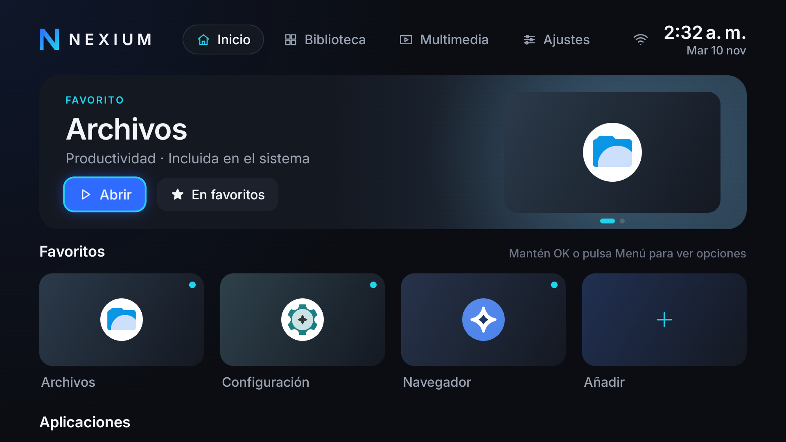

# Nexium-OS

> **Estado:** etapa 4.1 — diseño "Graphite & Ion" refinado (hero dinámico, gestión de favoritos, rejilla común) funcionando como launcher principal en la Raspberry Pi 5.

Nexium-OS es una experiencia Android TV premium para Raspberry Pi 5. Su primer
componente es **Nexium Launcher** (`dev.nexium.launcher`), un launcher propio en
Kotlin y Jetpack Compose for TV que se instala como aplicación normal, sin
modificar la ROM ni requerir root.

## Plataforma objetivo

| | |
|---|---|
| Hardware | Raspberry Pi 5 Model B Rev 1.1, 16 GB RAM |
| Sistema | LineageOS 24.0 (Android TV 17, SDK 37) — build KonstaKANG `rpi5_tv` |
| Pantalla | 1920×1080 @ 60 Hz, densidad 320 (xhdpi) |
| GPU | Broadcom V3D (Mesa GLES 3.1 / Vulkan 1.4) |

Detalles en [docs/dispositivo.md](docs/dispositivo.md).

## Principios

1. **Estabilidad:** el launcher del sistema (Catapult) nunca se deshabilita; es la red de seguridad.
2. **Rendimiento:** 60 fps sostenidos en la GPU V3D; sin efectos costosos en tiempo real.
3. **Seguridad:** sin root, sin permisos privilegiados, sin telemetría, sin anuncios.

## Documentación

- [Arquitectura](docs/arquitectura.md)
- [Identidad visual](docs/identidad-visual.md)
- [Entorno de desarrollo](docs/entorno.md)
- [Recuperación del dispositivo](docs/recuperacion.md)
- [Hoja de ruta](docs/hoja-de-ruta.md)
- Decisiones técnicas (ADR): [docs/decisiones/](docs/decisiones/)

## Convenciones

- Código, identificadores y mensajes de commit: **inglés**.
- Documentación: **español**.

## Seguridad

No subas claves de firma (`*.jks`, `*.keystore`), contraseñas, tokens,
`local.properties` ni logs del dispositivo. El `.gitignore` los excluye, pero
revisa siempre `git status` antes de un commit.

## Licencia

Apache License 2.0. Ver [LICENSE](LICENSE).

Incluye la tipografía **Inter** © The Inter Project Authors, bajo SIL Open
Font License 1.1 ([third_party/inter/OFL.txt](third_party/inter/OFL.txt)).
