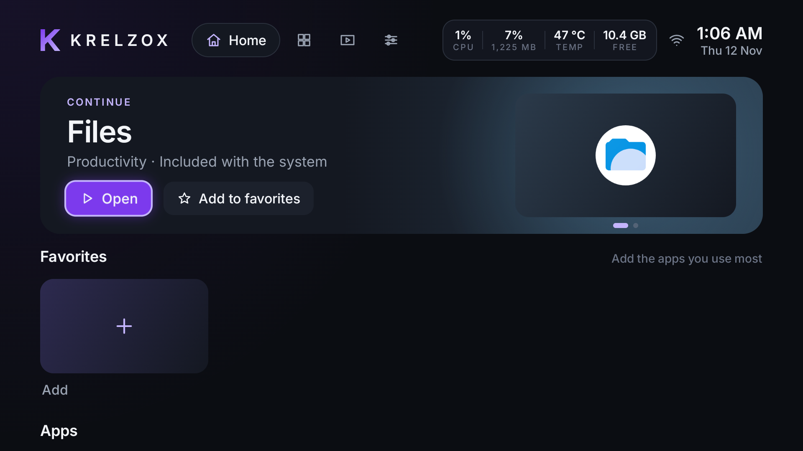
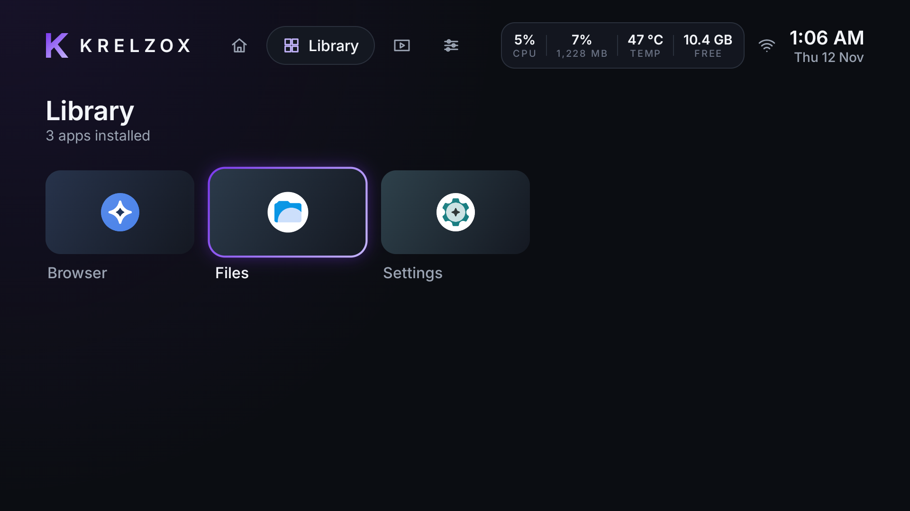
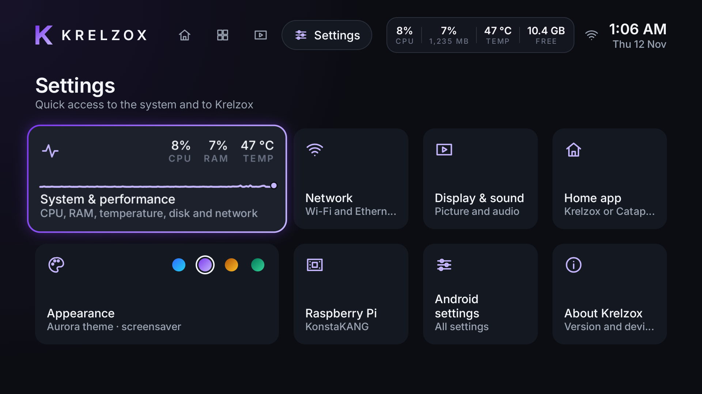
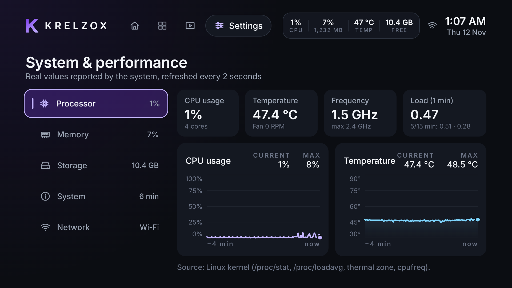
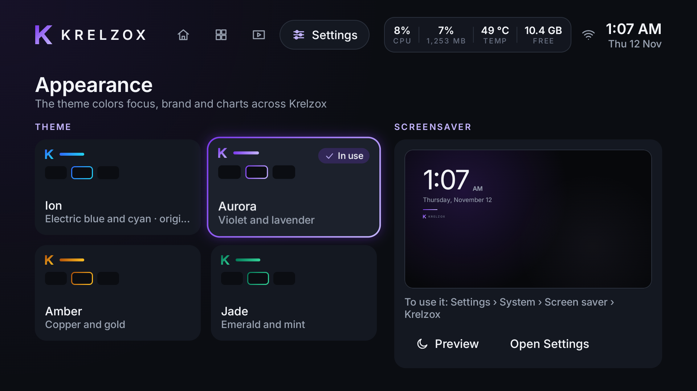
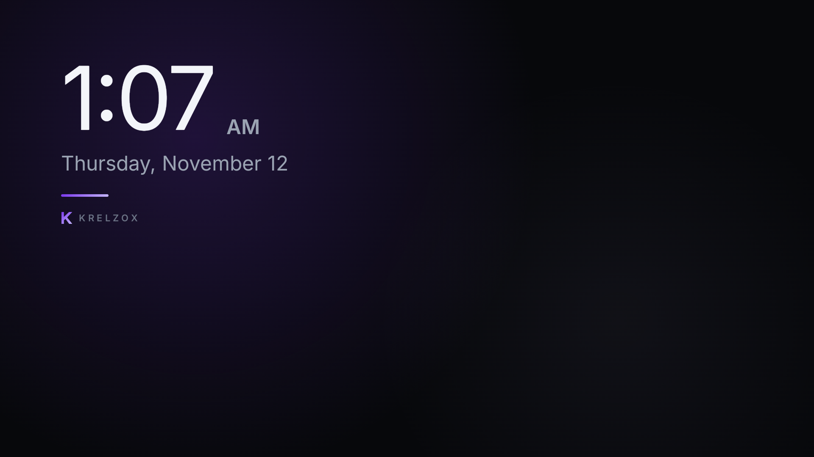

# Krelzox OS

[](https://github.com/Nach0t/Krelzox-OS/actions/workflows/android.yml)


**English** · [Español](README.es.md)

A premium Android TV experience for the Raspberry Pi 5. Its first component is
**Krelzox Launcher** (`dev.krelzox.launcher`): a home screen written in Kotlin and
Jetpack Compose for TV that installs as a regular app — no root, no ROM changes,
and the stock launcher always kept as a safety net.

*Formerly known as Nexium OS.*



## Contents

- [Screenshots](#screenshots)
- [Features](#features)
- [Technology](#technology)
- [Architecture](#architecture)
- [Requirements](#requirements)
- [Build and install](#build-and-install)
- [Raspberry Pi setup](#raspberry-pi-setup)
- [Remote access from the local network](#remote-access-from-the-local-network)
- [Administration](#administration)
- [Troubleshooting](#troubleshooting)
- [Development](#development)
- [Documentation](#documentation) · [Contributing](#contributing) · [Security](#security) · [License](#license)

## Screenshots

Captured on the reference Raspberry Pi 5 with the **Aurora** theme.

| Library | Settings |
|---|---|
|  |  |

| System & performance | Appearance |
|---|---|
|  |  |

| Screensaver |
|---|
|  |

## Features

**Home screen**
- Dynamic hero carousel: the app you were using (*Continue*), recent apps,
  favorites and suggestions.
- Favorites row with live reordering, plus an apps row; **Library** (all apps)
  and **Media** (video, audio and image apps) tabs.
- Built for the remote: every screen works with the D-pad, focus is never lost,
  and Back is hierarchical.

**Performance monitor**
- Always-on top-bar panel: CPU, RAM, temperature and free storage.
- Expanded view with live charts of the last 4 minutes (current, max, average).
- **System & performance** center in Settings: processor (usage, temperature,
  frequency, load, fan), memory, storage, system and network.
- Real values only, with their source on screen. If the system blocks a source,
  the metric says *Not available* — it is never estimated.

**Appearance and screensaver**
- Four themes — Ion (original), Aurora, Amber and Jade — that recolor the whole
  system at once: focus, brand mark, charts and screensaver. Each theme card
  previews its own focus before you pick it.
- Krelzox screensaver: time, date and the theme's light on deep graphite. It
  moves every minute to protect the screen and barely uses the CPU.
- A Raspberry Pi tile that tells you exactly where KonstaKANG's hardware
  settings are (Android does not let other apps open them directly).

**Reliability**
- Runs as the HOME app, with **safe mode**: after 3 crashes in 2 minutes it
  opens a minimal screen to pick another launcher or open Settings.
- The stock launcher (Catapult) is never disabled; a
  [recovery guide](docs/recuperacion.md) covers every way back.

**Performance and privacy**
- Baseline Profile + R8: 2.8 MB release APK; D-pad navigation with < 1 % janky
  frames even right after install; cold start well under 600 ms.
- A single, normal permission (`ACCESS_NETWORK_STATE`) — themes and the
  screensaver add none. No root, no telemetry, no ads, no network server.
- English and Spanish user interface.

## Technology

| Area | Stack |
|---|---|
| Language | Kotlin 2.4 (JVM target 17) |
| UI | Jetpack Compose (BOM 2026.09) + Compose for TV Material 1.1, Inter typeface |
| State and storage | AndroidX Lifecycle / ViewModel, Kotlin coroutines, DataStore |
| Build | Gradle 9.9 (wrapper), Android Gradle Plugin 9.5, R8, Baseline Profiles |
| Tests | JUnit 4 (unit), UI Automator + AndroidX Test (device), Macrobenchmark |
| CI | GitHub Actions, Dependabot, CodeQL, dependency graph |

## Architecture

Krelzox is a single Android app split into Gradle modules with one-way
dependencies:

```
app/                 Launcher: activity, shell, Home / Library / Media / Settings,
                     performance UI, screensaver (DreamService), crash-loop safe mode
 ├─ core/designsystem/   Tokens, themes, icons, charts — no data dependencies
 └─ core/data/           Installed apps, favorites, recents, network, system metrics
baselineprofile/     Baseline Profile generator and startup benchmarks (runs on the device)
docs/                Architecture, visual identity, roadmap, ADRs (Spanish), images
scripts/             Helper scripts (remote access)
```

The launcher reads system information locally (`/proc`, thermal zones,
`PackageManager`, `ConnectivityManager`) and stores preferences on the device
only; it has no backend and opens no network ports. Details:
[docs/arquitectura.md](docs/arquitectura.md).

## Requirements

**Development machine**
- JDK 21 and the Android SDK with platform 37.
- ADB (Android platform-tools). Scripts expect it in `platform-tools/` at the
  repository root (not versioned).
- Optional, for remote access: [scrcpy](https://github.com/Genymobile/scrcpy).

**Device**

| | |
|---|---|
| Hardware | Raspberry Pi 5 Model B Rev 1.1, 16 GB RAM |
| System | LineageOS 24.0 (Android TV 17, SDK 37), KonstaKANG `rpi5_tv` build |
| Display | 1920×1080 @ 60 Hz, 320 dpi (960×540 dp) |
| GPU | Broadcom V3D (Mesa GLES 3.1 / Vulkan 1.4) |

The device has no Google Mobile Services. Krelzox should run on other Android TV
devices with SDK 31+, but it is designed and tested on this one only.

## Build and install

```sh
./gradlew assembleRelease          # app/build/outputs/apk/release/app-release-unsigned.apk
```

Sign the APK (for development, the local debug key is enough) and install it:

```sh
apksigner sign --ks ~/.android/debug.keystore --ks-pass pass:android \
  --ks-key-alias androiddebugkey --out krelzox.apk \
  app/build/outputs/apk/release/app-release-unsigned.apk
adb install -r krelzox.apk
```

Before making it the home app, check that it starts as a normal app:

```sh
adb shell am start -n dev.krelzox.launcher/.MainActivity
```

Then make it the home app (fully reversible — see the [recovery guide](docs/recuperacion.md)):

```sh
adb shell cmd role add-role-holder android.app.role.HOME dev.krelzox.launcher
```

Windows equivalents are in [docs/entorno.md](docs/entorno.md) (Spanish).

## Raspberry Pi setup

1. Install the KonstaKANG LineageOS 24.0 `rpi5_tv` build following its own
   instructions.
2. Enable **Developer options** (tap the build number seven times in the
   system's *About* screen) and turn on **ADB over network** there.
3. Note the device's IP address (Settings › Network). Ask your router for a
   **DHCP reservation** so the address does not change.
4. From the development machine, connect and accept the authorization prompt
   on the TV:

   ```sh
   adb connect <PI_IP>:5555
   adb devices -l          # the state must be "device"
   ```

5. Install Krelzox and set it as the home app ([Build and install](#build-and-install)).
6. Optional: set the Krelzox screensaver in Settings › System › Screen saver.

Network debugging may need to be enabled again after a reboot
([docs/recuperacion.md](docs/recuperacion.md)).

## Remote access from the local network

Krelzox has no web interface: it is a TV app. To see and control it from a PC
on the same network, use **scrcpy**, which mirrors the TV screen and sends
keyboard and mouse input over ADB.

Install it once (Windows: `winget install --id Genymobile.scrcpy -e`; other
systems: see the scrcpy documentation), then run from the repository root:

```powershell
.\scripts\remote.ps1                         # finds the Pi through mDNS
.\scripts\remote.ps1 -Address <PI_IP>:5555   # or give the address
.\scripts\remote.ps1 --max-size 1280         # extra arguments go to scrcpy
```

The script uses the repository's ADB so it does not conflict with the ADB that
ships with scrcpy. On other systems, run `adb connect <PI_IP>:5555` and then
`scrcpy -s <PI_IP>:5555`.

| Action on the TV | In the scrcpy window |
|---|---|
| D-pad | Arrow keys |
| OK | Enter |
| Back | Right-click, or `Alt`+`B` |
| Home | Middle-click, or `Alt`+`H` |

**Security.** ADB gives full control of the device to every computer whose key
you authorize, and its traffic is not encrypted. Use it only on a trusted home
network, never forward port 5555 on your router, and turn network debugging off
when you do not need it. You can revoke authorized computers in Developer
options › *Revoke debugging authorizations*.

## Administration

| Task | Command |
|---|---|
| Check the installed version | `adb shell dumpsys package dev.krelzox.launcher \| grep versionName` |
| Update | Build, sign and `adb install -r krelzox.apk` (data is kept) |
| Restart the launcher | `adb shell am force-stop dev.krelzox.launcher`, then press Home |
| See who is the home app | `adb shell cmd role get-role-holders android.app.role.HOME` |
| Go back to the stock launcher | `adb shell cmd role add-role-holder android.app.role.HOME org.lineageos.tv.launcher` |
| Read crash logs | `adb logcat -d -b crash` |
| Take a screenshot | `adb exec-out screencap -p > screen.png` |

## Troubleshooting

| Problem | Solution |
|---|---|
| `adb connect` times out | Check that the Pi and the PC are on the same network and that network debugging is still enabled (it can turn off after a reboot). |
| Device shows as `unauthorized` | Accept the prompt on the TV, or revoke authorizations in Developer options and connect again. |
| Device shows as `offline` | `adb disconnect`, then `adb connect <PI_IP>:5555` again. |
| scrcpy closes right away or restarts ADB | Use `scripts/remote.ps1`, or set the `ADB` environment variable to the same `adb` you use elsewhere. |
| Krelzox crashes repeatedly | Safe mode opens automatically after 3 crashes in 2 minutes; pick another launcher there. See the [recovery guide](docs/recuperacion.md). |
| A metric shows *Not available* | The system blocks that source for normal apps; Krelzox never estimates values. |
| The screensaver does not start | Select *Krelzox* in Settings › System › Screen saver. |

## Development

| Command | What it does | Where |
|---|---|---|
| `./gradlew testDebugUnitTest lintDebug` | Unit tests and lint | CI + local |
| `./gradlew assembleRelease` | Release build (R8 + Baseline Profile) | CI + local |
| `./gradlew :app:connectedDebugAndroidTest` | D-pad focus UI tests | Device |
| `./gradlew :app:generateBaselineProfile -Pandroid.injected.androidTest.leaveApksInstalledAfterRun=true` | Regenerates the Baseline Profile (the flag keeps Krelzox and its data installed) | Device |
| `./gradlew :baselineprofile:connectedBenchmarkReleaseAndroidTest` | Cold-start Macrobenchmark | Device |

Debug builds use the package `dev.krelzox.launcher.debug`, so tests never replace
or uninstall the launcher in use. Device procedures and results:
[docs/rendimiento.md](docs/rendimiento.md).

CI (GitHub Actions) runs unit tests, lint, the release build and compiles the
device tests on every push and pull request, and posts a summary (tests, lint,
APK size, Baseline Profile). Dependabot proposes weekly dependency updates.

## Documentation

Detailed documentation is written in **Spanish**:

- [Architecture](docs/arquitectura.md) · [Visual identity](docs/identidad-visual.md) · [Roadmap](docs/hoja-de-ruta.md)
- [Development environment](docs/entorno.md) · [Performance and device tests](docs/rendimiento.md)
- [Device recovery](docs/recuperacion.md) · [Reference device](docs/dispositivo.md)
- Architecture decision records: [docs/decisiones/](docs/decisiones/)

## Contributing

Contributions are welcome. Read the [contributing guide](CONTRIBUTING.md) and
the [Code of Conduct](CODE_OF_CONDUCT.md) before opening an issue or pull
request. Accessibility status and known limitations are described in
[ACCESSIBILITY.md](ACCESSIBILITY.md).

Code, identifiers and commit messages are in English; the README is in English
and Spanish, and detailed documentation in `docs/` is in Spanish.

## Security

To report a vulnerability, follow the [security policy](SECURITY.md) — never
use public issues.

Never commit signing keys (`*.jks`, `*.keystore`), passwords, tokens,
`local.properties` or device logs. `.gitignore` excludes them, but always check
`git status` before committing. Screenshots of the network screen show the
device's IP addresses and must not be published.

## License

Apache License 2.0 — see [LICENSE](LICENSE).

Includes the **Inter** typeface © The Inter Project Authors, under the SIL Open
Font License 1.1 ([third_party/inter/OFL.txt](third_party/inter/OFL.txt)).
